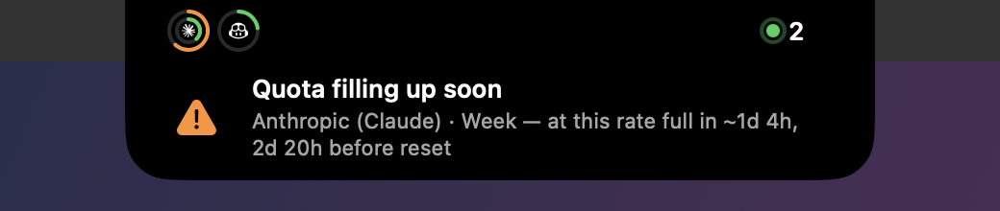
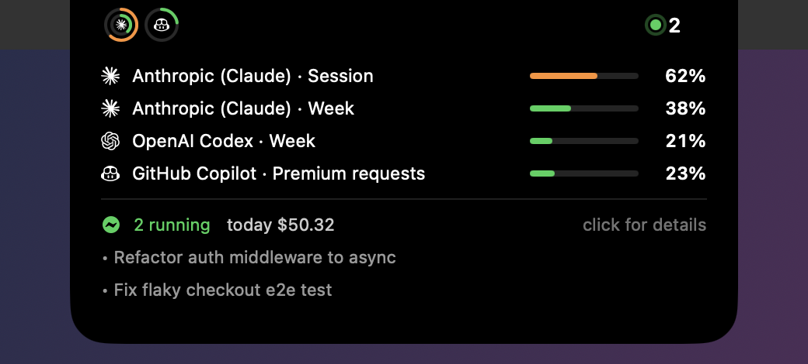
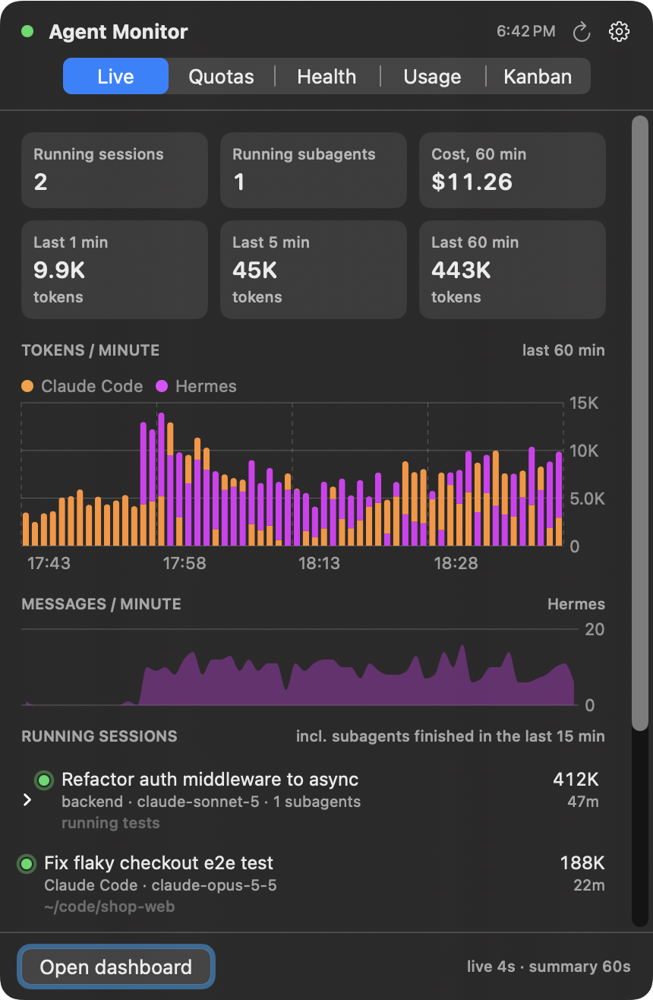
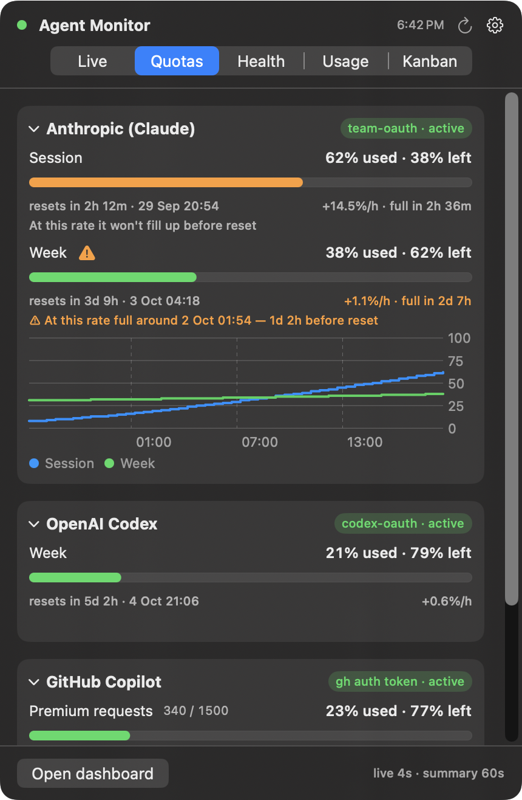
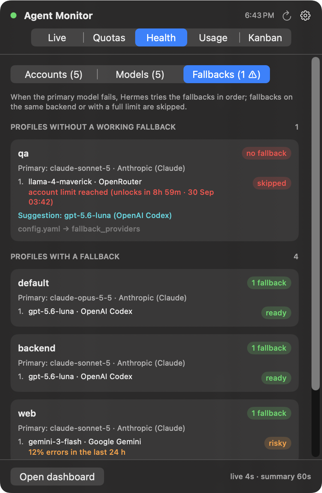
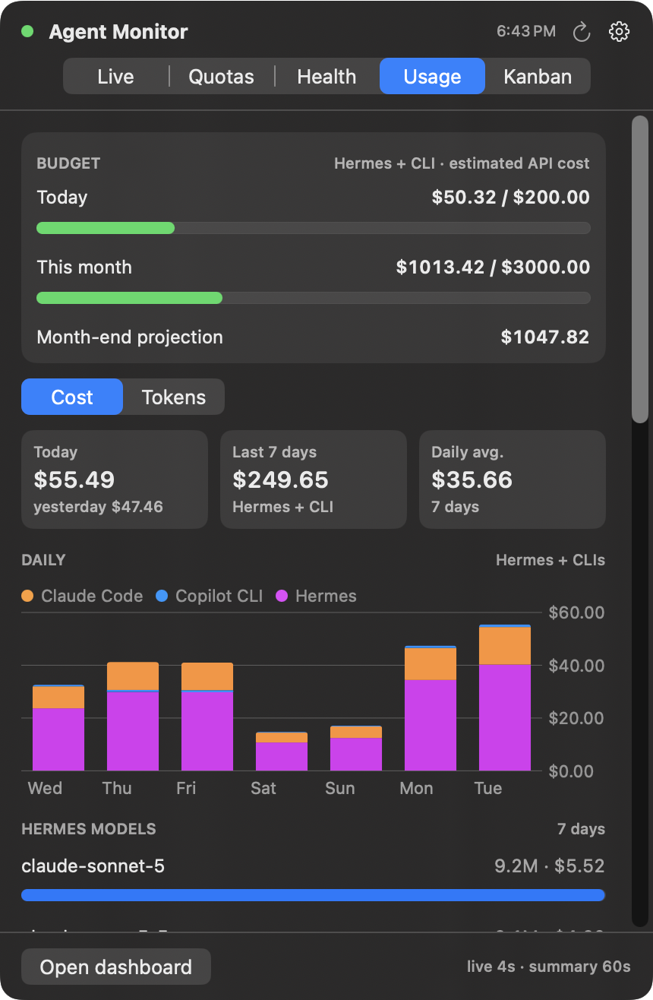
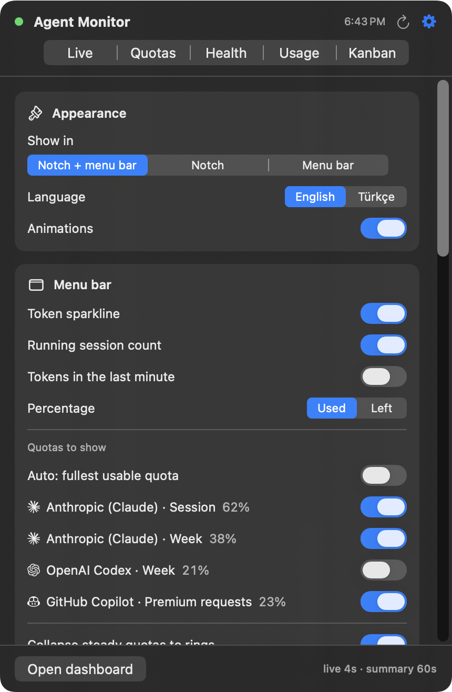

# Agent Monitor

Read-only dashboard for [Hermes Agent](https://github.com/NousResearch/hermes-agent) usage plus Claude Code
and GitHub Copilot CLI: live sessions, provider quotas, account/model health, fallback chains, cost and kanban.
It runs entirely on your Mac.

- **Dashboard server** — `panel.py` (+ `clis.py`, `health.py`) on http://127.0.0.1:8777, run with Hermes' own Python.
- **Agent Bar** — SwiftUI menu bar app (`menubar/AgentBar.swift`); on MacBooks with a notch it also lives
  in the notch as an island (quota rings, running sessions, pop-down events, full panel on click).

It never edits Hermes' data or config; its own writes go to `panel.db` (quota history). The one exception is
Hermes' own account-usage helpers, which may refresh an expiring OAuth token while fetching quotas — as Hermes itself does.

<p align="center">
  <br>
  <sub>Peeks beside the camera when a quota moves or a session starts</sub>
</p>
<p align="center">
  <br>
  <sub>Pops alerts down from the notch</sub>
</p>
<p align="center">
  <br>
  <sub>Hover for a mini dashboard, click for the full panel</sub>
</p>

| Live | Quotas | Health · fallbacks |
|:---:|:---:|:---:|
|  |  |  |
| **Usage · budget** | **Settings** | |
|  |  | |

<sub>Screenshots use synthetic demo data.</sub>

## Features

- **Live** — running sessions and subagents (Hermes, Claude Code, Copilot CLI) grouped by account and profile,
  tokens and cost per minute; each session shows whether it is **working**, **waiting for you**, **needs
  approval** or looks **stuck**, plus its context size
- **Agent attention** — "finished, your turn" in the notch for the sessions you are using, notifications when an
  agent needs approval, makes no progress for 10+ minutes, repeats the same tool call or carries a very large
  context (unattended workers such as Hermes kanban jobs don't ping you)
- **Model speed** — median / p90 turn time per model over the last 24 h
- **Quotas** — per-provider windows (Claude session/week, Codex month, Copilot premium requests) with
  burn rate and a "fills before reset" forecast; several Claude accounts in Hermes are shown separately,
  with a hint when one is nearly full and another has room; steady quotas collapse and reopen on every 2 % step
- **Health** — per-account status and errors, per-model error rates, and each profile's fallback chain
  (which fallbacks Hermes would actually skip and why)
- **Usage** — daily/monthly budget with month-end projection, 7-day costs, top models, profiles and sessions
- **Kanban** — running, blocked and failing cards
- **Notifications** — quota 80/95 % and "filling soon", budget, blocked cards, failing models
- **Notch island** (MacBooks with a notch): stays invisible until hovered (or always shows rings and the working
  count), peeks beside the camera when a quota moves or a session starts working, pops alerts down from the notch,
  lists every session in a scrollable hover panel and drops the full panel on click
- **Desktop widget** (small / medium / large): quota rings and bars, running sessions, today's and this month's
  cost, models that need attention. Agent Bar refreshes it when a quota moves or a session starts
- **Settings tab** (⚙): where it shows (notch + menu bar, notch only, menu bar only), what the menu bar and
  the notch display, which quotas, collapse step and timings, hover panel contents, notifications, budget,
  refresh interval, language (English / Türkçe) and *Restore defaults*

## Requirements

- macOS 14+ on Apple silicon, Xcode Command Line Tools (`xcode-select --install`) for `swiftc`
- Hermes Agent installed in `~/.hermes` (the server imports Hermes modules and reads its databases/logs).
  Tested with Hermes Agent 0.21.5; it relies on some Hermes internals, so a future Hermes release may need an update here.

## Install

The scripts expect the repo at `~/agent-monitor`:

```sh
git clone <this repository's URL> ~/agent-monitor
cd ~/agent-monitor
./make-menubar.sh                        # builds and installs /Applications/Agent Bar.app
open /Applications/"Agent Bar.app"      # starts the dashboard server by itself when it is down
./make-app.sh                            # optional: ~/Desktop/Agent Monitor.app (browser dashboard)
```

Everything else is in Agent Bar's Settings tab (⚙), including *Launch at login*.

**Widget:** macOS only lists widgets that are built by Xcode and signed with a real identity. `make-menubar.sh`
builds the app and widget with Xcode from `menubar/project.yml` when an *Apple Development* certificate is in your
keychain (a free Apple ID in Xcode → Settings → Accounts is enough) and [XcodeGen](https://github.com/yonaskolb/XcodeGen)
is installed (`brew install xcodegen`); otherwise it builds the app alone with `swiftc`. The signing identity and
team are read from your keychain at build time. Add it via right-click on the desktop → *Edit Widgets* → search "Agent Monitor". The widget is
sandboxed with network-client access only and follows the system language.

## MCP server (for agents)

`mcp_server.py` exposes the same data to agents over MCP (stdio, read-only), so an orchestrator can check quotas,
model health and budget before it delegates work to a subagent or picks a model:

| Tool | What it answers |
|---|---|
| `recommend_model` | best models to route to right now (health, usable account, quota headroom, turn speed), with reasons and exclusions |
| `get_quota_status` | % used/left per provider window, reset, burn rate, "fills before reset" |
| `get_model_health` | per-model status, calls, error rate and codes, cooldowns (no upstream error text) |
| `get_fallback_chains` | per Hermes profile: which fallbacks would really be tried, and why others are skipped |
| `get_budget` | today / month to date / month-end projection vs. the budgets set in Agent Bar |
| `get_running_counts` | running sessions and subagents per source and profile, by state (counts only, no titles) |
| `get_agent_attention` | agents that need approval, wait for you, look stuck, loop or carry a huge context |

Session titles and provider error messages are never returned, so text from other sessions can't steer the
calling agent. The dashboard server must be running (Agent Bar starts it).

```sh
claude mcp add --scope user agent-monitor -- ~/agent-monitor/mcp.sh      # Claude Code
```

Hermes (`~/.hermes/config.yaml`):

```yaml
mcp_servers:
  agent-monitor:
    command: "/path/to/agent-monitor/mcp.sh"
    sampling:
      enabled: false
```

## Privacy & network

- Reads local data only: Hermes' `~/.hermes` (session databases, credential pool status, profile configs,
  error logs), Claude Code transcripts in `~/.claude/projects`, and Copilot CLI's `~/.copilot/session-store.db`.
  Credentials are only used in memory for the quota requests below and are never stored or returned by the API.
- The server listens on `127.0.0.1:8777` only, answers only requests addressed to `127.0.0.1`/`localhost`
  (DNS-rebinding guard) and refuses requests that browsers mark as coming from another site, so other machines
  and web pages can neither read it nor trigger it. A forced quota refresh runs at most every 30 s.
- Anyone logged in to the same Mac under another account can still reach a localhost port; on a shared Mac,
  quit Agent Bar when you're not using it.
- Outbound requests are limited to quota/usage lookups with your own credentials: the providers' usage
  endpoints via Hermes' account-usage helpers (Anthropic, OpenAI Codex, OpenRouter) and GitHub's
  `api.github.com/copilot_internal/user` for Copilot (an undocumented endpoint the Copilot clients use;
  it may change without notice).
- No telemetry. Quota history is kept locally in `panel.db`.

## Development

- Restart the server after Python changes: stop the `panel.py` listener on :8777, then `./run.sh`
  (Agent Bar restarts it on its own within seconds if *Start the dashboard server* is on).
- `./make-screenshots.sh <dir> [live quota health health-models health-chains usage kanban settings]` renders
  every popover view with live data (the images contain your real sessions and costs — don't publish them as-is).
- Island states can be driven for testing with the distributed notification `local.agent.bar.island`
  (object: `event`, `peek`, `peek-sessions`, `hover`, `compact`, `drop`).

Provider logos in `menubar/icons` come from [Simple Icons](https://simpleicons.org) (CC0); the marks belong to their owners.

## License

[MIT](LICENSE)
